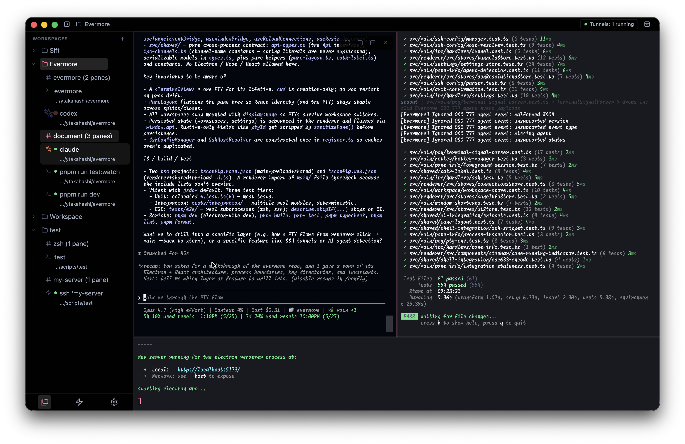

# Evermore

Evermore is a smart terminal workspace that gives you an at-a-glance overview of your terminals and
connections.

## Features

### Core Features

Evermore provides a highly informative workspace by default:

- **Persistent Workspace Layouts**: The sidebar workspace, tab structure, and split-pane terminal
  layouts are persisted across sessions.
- **Pane Status Indicators**: Sidebar lists reflect whether a terminal pane is currently `running`
  or `idle`, using system-level process monitoring.
- **Active Process & Command Labels**: Sidebar pane items display the name of the active foreground
  program (e.g., `node`, `ssh`) or the cwd when `idle`.
- **AI Agent Awareness**: Detects AI agent CLIs and replaces the generic terminal icon with an agent
  icon.
- **SSH Config & Tunnel Management**: Discovers host shortcuts from `~/.ssh/config` for one-click
  terminal connections, and manages SSH port-forwarding tunnels with real-time status.

### Shell-Integrated Features (Zsh)

Zsh shell integration gives the workspace UI shell-level accuracy and responsiveness:

- **Auto-Injection**: Enabled by default; starting a Zsh pane automatically sets up integration.
- **Real-Time Directory Sync**: The pane's cwd updates instantly as you change directories.
- **Exact Command & Alias Labels**: Pane labels in the sidebar display the exact command line you
  typed (such as `pnpm run dev`), rather than generic process names (such as `node`).

### AI Agent Hook Integration

Evermore helps you monitor and operate AI agents across workspaces:

- **Agents Overview**: The **Agents** view groups prompts and activity by workspace, with projects
  first and home last.
- **Terminal Preview**: Select a session to use its terminal beside the list. Space toggles the
  preview, and **×** closes it.
- **Keyboard Navigation**: Enter focuses the terminal, `Command+Left` returns to the list,
  `Command+Right` focuses the previewed terminal, and `Command+Enter` opens the session in its
  workspace. Esc reaches the agent from the terminal and returns to the workspace outside it.
- **Agent Launcher**: Use **Launch Agent…** (`Command+Shift+N`, customizable in **Settings >
  Shortcuts**), **+**, or **N** in the list to run a command preset in a project or home. From
  Agents, the picker starts with the cursor row's workspace, and the new terminal takes focus when
  ready.
- **Command Presets**: Manage shared and project-specific commands in **Settings > Agent presets**.
- **Live Agent Status**: With AI agent hooks configured, the sidebar shows active turns, permission
  prompts awaiting input, and finished turns.

## Recommended Setup

- **SSH Config**: Open **Settings > Recommended setup** to view and copy recommended SSH tunnel
  reliability configuration (such as keep-alives) that keep background port-forwarding tunnels
  reliable.
- **Zsh Auto-Injection**: Enabled by default. You can toggle this behavior under **Settings >
  Advanced features**.
- **Manual Shell Setup**: Copy the Shell integration (zsh) snippet from **Settings > Recommended
  setup** if you run custom shells or subshells, or prefer to configure shell integration manually.
- **AI Agent Hooks**: Open **Settings > AI Integration** to copy the Evermore agent status helper
  and agent hook snippets.
